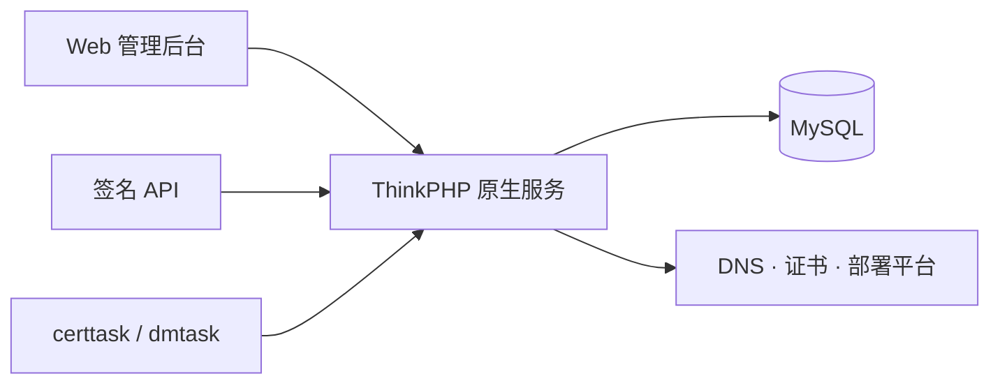

<div align="center">


# 聚合CC-DNS

**一个面板，管理域名解析、SSL 证书和自动化任务。**

基于彩虹聚合 DNS 管理系统的原生增强分支 · ThinkPHP + MySQL + Bootstrap

[](https://github.com/paijishult/dnsmgr/actions/workflows/docker-build.yml)
[](composer.json)
[](https://github.com/paijishult/dnsmgr/pkgs/container/dnsmgr)
[](LICENSE)
[](https://github.com/netcccyun/dnsmgr)

[功能全览](#功能全览) · [支持平台](#支持平台) · [快速部署](#快速部署) · [开放 API](#开放-api) · [安全与隐私](#安全与隐私) · [上游与许可](#上游与许可)

</div>

---

> **项目来源**：本仓库由 [paijishult/dnsmgr](https://github.com/paijishult/dnsmgr) 维护，基于 [netcccyun/dnsmgr](https://github.com/netcccyun/dnsmgr) 二次开发。感谢上游作者 **消失的彩虹海** 与所有贡献者。上游项目、原作者和本分支的归属分别保留，完整版权声明见 [LICENSE](LICENSE)。

## 功能全览

| 模块 | 可以做什么 |
| --- | --- |
| **域名与账户** | 多平台 DNS 账户、域名导入/创建、分类、备注、到期查询与提醒、账户可用性检测 |
| **解析管理** | 查询、添加、修改、删除、启停记录，批量导入/编辑、线路、备注、权重、别名和智能解析；能力随平台而异 |
| **变更与快照** | 手动/自动快照、变更前后差异、一次性预览凭证、执行前指纹检查、安全回滚预览 |
| **后台任务中心** | 将已确认的 DNS 计划加入后台，逐项进度与结果、失败续跑、取消、历史快照；复用原生计划任务 |
| **多用户与授权** | 管理员、普通用户、按域名授权，以及域名快捷登录对接 |
| **SSL 证书** | ACME 与云平台证书账户、DNS 验证、CNAME 代理、自动续签、手动导入、证书和私钥下载 |
| **证书部署** | 面板、WAF/CDN、云平台、Kubernetes、SSH、FTP、S3 与本机部署，共 50 个模块 |
| **线上 TLS 验收** | 可选核对线上证书、主机名、可信证书链与 SHA-256 指纹；部署完成后验收失败只重试验收 |
| **容灾与定时** | Ping/TCP/HTTP(S) 检测、暂停/恢复/切换记录、连续检测阈值、单次/每日/每周/每月定时切换 |
| **Cloudflare 增强** | SaaS 自定义主机名、验证信息、回退源、Tunnel、公共主机名、CIDR 和主机名路由 |
| **Cloudflare 优选 IP** | 获取优选 IP、任务管理、定时更新解析与结果通知 |
| **开放 API** | 多密钥、Scope、域名范围、IP/CIDR 白名单、过期时间、原子限流、独立私钥下载权限、内置接口文档 |
| **审计与通知** | 后台/API 操作审计、拒绝记录、脱敏参数、筛选与 CSV 导出；邮件及多种即时通知渠道 |
| **界面与交付** | Modern 默认界面、19 款皮肤、手机适配、`⌘K` / `Ctrl+K` 快速搜索、双架构 Docker 镜像与发布前检查 |

### 这次增强的使用入口

- **解析页面 → 变更与快照**：先预览差异，再立即执行或加入后台任务；变更前自动保留恢复点。
- **后台批量任务**：查看逐项进度、错误与快照，请求取消或续跑尚未完成的项目。
- **SSL 证书 → 部署任务**：按需开启线上 TLS 验收，明确区分“已部署”和“验收通过”。
- **API 接口 → API 密钥 / 接口文档**：创建最小权限密钥，直接查看参数、返回示例和 curl 示例。
- **审计日志**：按来源、用户、密钥、IP、结果与时间检索，导出经过防公式注入处理的 CSV。

<details>
<summary><strong>展开：变更与任务的安全边界</strong></summary>

- 每次计划最多 500 项；预览输入最多 1MB，含原记录的计划最多 2MB。
- 预览绑定用户/API 密钥与域名账户，10 分钟有效，每个用户跨密钥最多保留 3 个未消费预览。
- 执行前及执行过程中核对记录指纹；检测到外部变更、平台结果不一致或无法唯一定位时停止。
- 每个域名保留最近 100 个快照，单快照最多 8MB，完整域名读取上限 10000 条。
- 后台计划执行窗口为 24 小时；取消保留已完成项目；不确定的云端执行结果需要重新预览，不盲目重放。
- 根域名 NS/SOA 及无法无损还原元数据的平台有回滚限制，详见[修改与升级文档](docs/changes-2026-10-19.md)。

</details>

## 支持平台

### DNS：22 个原生模块

阿里云、腾讯云 DNSPod、华为云、百度云、西部数码、火山引擎、京东云、DNSLA、青云、宝塔域名、Cloudflare、AWS Route 53、NameSilo、HE DNS、Spaceship、PowerDNS、Technitium、阿里云 ESA、腾讯云 EdgeOne、同系统对接、GoEdge 智能 DNS、dynv6。

### 证书：8 个账户与 ACME 通道

Let's Encrypt、ZeroSSL、Google SSL、LiteSSL、腾讯云免费 SSL、阿里云免费 SSL、UCloud 免费 SSL、自定义 ACME；同时支持手动导入已有证书。

<details>
<summary><strong>展开：全部 50 个证书部署模块</strong></summary>

| 类别 | 模块 |
| --- | --- |
| 面板与服务 | 宝塔、宝塔 Win 极速版、Kangle 用户/Kangle 管理员、雷池 WAF、堡塔云 WAF、Cdnfly、LeCDN、GoEdge、南墙 WAF、1Panel、MW 面板、AcePanel、耗子面板、小皮面板、AMH、CloudPanel、DirectAdmin、群晖、Lucky、飞牛 OS、Nginx Proxy Manager、Proxmox VE、Kubernetes |
| 云平台与 CDN | 阿里云、腾讯云、华为云、UCloud、七牛云、多吉云、AxisNow、又拍云、百度云、金山云、火山引擎、西部数码、网宿科技、白山云、天翼云、括彩云、全栈云、雨云、uniCloud、AWS、Gcore、Cachefly |
| 服务器与存储 | SSH 服务器、FTP 服务器、S3 存储、复制到本机 |

具体参数、平台权限和功能差异以后台表单及对应平台接口为准。模块清单来自 [DnsHelper](app/lib/DnsHelper.php)、[CertHelper](app/lib/CertHelper.php) 与 [DeployHelper](app/lib/DeployHelper.php)。

</details>

## 原生架构



沿用现有 PHP 适配器与任务进程，后台任务中心复用每分钟计划任务，不需要额外部署 Redis、消息队列或前端构建服务。

## 快速部署

### Docker · 使用现有数据库

本分支镜像：`ghcr.io/paijishult/dnsmgr`，提供 `latest` 与 `sha-<提交前7位>` 标签。

```bash
docker run -d \
  --name dnsmgr \
  --restart unless-stopped \
  -p 127.0.0.1:8081:80 \
  -v /var/dnsmgr:/app/www \
  ghcr.io/paijishult/dnsmgr:latest
```

访问 `http://127.0.0.1:8081` 完成安装并填写自己的数据库连接。远程服务器可通过 HTTPS 反向代理或 SSH 隧道访问；示例默认只绑定回环地址。

### Docker Compose · 同时部署数据库

将以下内容保存为 `compose.yaml`。数据库不向主机发布 3306 端口，安装程序使用专用的 `dnsmgr` 数据库用户。

```yaml
services:
  web:
    image: ghcr.io/paijishult/dnsmgr:latest
    restart: unless-stopped
    ports:
      - "127.0.0.1:8081:80"
    volumes:
      - ./data/app:/app/www
    depends_on:
      db:
        condition: service_healthy

  db:
    image: mysql:8.4
    restart: unless-stopped
    environment:
      TZ: Asia/Shanghai
      MYSQL_DATABASE: dnsmgr
      MYSQL_USER: dnsmgr
      MYSQL_PASSWORD: ${DNSMGR_DB_PASSWORD:?请先创建本地 .env.compose}
      MYSQL_ROOT_PASSWORD: ${DNSMGR_ROOT_PASSWORD:?请先创建本地 .env.compose}
    volumes:
      - ./data/mysql:/var/lib/mysql
    healthcheck:
      test: ["CMD-SHELL", 'mysqladmin ping -h 127.0.0.1 -u"$${MYSQL_USER}" -p"$${MYSQL_PASSWORD}" --silent']
      interval: 10s
      timeout: 5s
      retries: 20
```

在本机生成独立的随机密码，再启动：

```bash
umask 077
printf 'DNSMGR_DB_PASSWORD=%s\nDNSMGR_ROOT_PASSWORD=%s\n' \
  "$(openssl rand -hex 32)" "$(openssl rand -hex 32)" > .env.compose
docker compose --env-file .env.compose up -d
```

安装页填写：主机 `db`、数据库 `dnsmgr`、用户 `dnsmgr`，密码使用本地 `.env.compose` 中的 `DNSMGR_DB_PASSWORD`。不要提交或公开该文件。变量及初始化行为参见 [MySQL 官方镜像文档](https://github.com/docker-library/docs/blob/master/mysql/README.md)。

### 自行部署 PHP

| 项目 | 要求 |
| --- | --- |
| PHP | 8.2+，扩展依赖以 [composer.json](composer.json) 为准 |
| 数据库 | MySQL；CI 验证 5.6 / 8.0 / 8.4，新的部署示例使用 8.4 |
| Web 目录 | 必须指向项目的 `public/` |
| Web 服务器 | Nginx / Apache 等，配置 ThinkPHP 伪静态 |
| 任务 | 每分钟 `php think certtask`；容灾功能需 Swoole 与 `php think dmtask` |

```bash
composer install --no-dev --prefer-dist
```

然后访问站点完成安装。Nginx 的站点根目录设置为 `<项目路径>/public`，转发规则可使用：

```nginx
location / {
    try_files $uri $uri/ /index.php?$query_string;
}
```

需要另行配置站点的 PHP-FPM 转发。CLI 与 PHP-FPM 应使用一致的 PHP 版本、扩展和账户权限。

### 升级

1. 备份数据库、`.env` 与持久化目录，停止旧版本的长驻任务及 cron 调用。
2. 更新代码/依赖或容器镜像；新表由幂等迁移创建，数据库用户需要相应建表权限。
3. 重启任务进程，确认系统心跳、解析列表、证书任务和后台任务中心状态。

升级不能只在原容器里 `docker restart`：更新镜像后需要重新创建容器。详见[完整修改与升级文档](docs/changes-2026-10-19.md)。

## 开放 API

新密钥使用原生 POST 签名协议：

```text
POST /api/<接口路径>
keyid + timestamp + sign
sign = md5(keyid + timestamp + secret)
```

原有的用户 API（`uid + timestamp + sign`）继续兼容。后台内置接口文档提供各接口的参数、返回示例和 curl 用法。

- Scope 覆盖域名、解析、证书、部署、容灾、定时、优选 IP、Cloudflare、日志与系统统计。
- 每个密钥可设置域名范围、IP/CIDR 白名单、调用频率及过期时间；Secret 仅创建或重置时展示。
- 证书私钥下载单独授权；API 不返回 DNS/证书/部署账户名称、地址及凭据。
- SSH、FTP、本机和 S3 等敏感部署类型的创建/配置修改仅开放给后台，API 可执行已经配置的任务。
- 新增快照、预览、应用、回滚预览及后台任务接口，参数与 Scope 见[新增 API 清单](docs/changes-2026-10-19.md#新增-api)。

## 安全与隐私

| 边界 | 当前措施 |
| --- | --- |
| 登录与浏览器请求 | 密码验证、TOTP、尝试次数限制、待验证状态限时、会话更新、CSRF 和来源校验；通知测试使用受保护的 POST |
| 用户与 API 权限 | 域名授权、Scope、IP 白名单、独立私钥下载权限、锁内重新授权 |
| DNS 写入 | 平台域名/Zone ID 核实、记录归属校验、变更快照、指纹检测与实际结果核对 |
| 任务执行 | 非持久主库会话锁、锁内刷新、成功检查点、凭据撤销检查、失败重试与取消边界 |
| 外部连接 | 云服务/ACME 的 TLS 校验；线上验收仅允许证书范围内的公网目标并固定解析 IP |
| 数据输出 | 页面按上下文转义、API 返回脱敏、审计参数脱敏、CSV 防公式注入、生产兜底异常隐藏内部细节 |
| 发布内容 | Gitleaks 检查源码与 Git 历史，核对已知公开常量/格式字符串误报；禁止提交本地环境和运行数据 |

**存储范围需要明确**：API Secret 使用 AES-256-GCM 加密保存；DNS/部署账户配置、证书私钥、TXT 记录和数据库备份仍属于敏感业务数据，应保护数据库、持久化目录与备份。本项目不会把这些业务凭据放进代码仓库。

多实例部署需要共享可靠的 runtime 文件锁目录；升级前停掉旧进程。自签名服务应配置受信任 CA；Kubernetes 可使用原生 kubeconfig CA。详细边界、回滚限制和测试范围见[修改文档](docs/changes-2026-10-19.md)。安全问题的报告方式与提交前检查见 [SECURITY.md](SECURITY.md)。

## 自动验证与镜像发布

| 检查 | 覆盖 |
| --- | --- |
| PHP | 8.2 / 8.3 / 8.4；语法、认证、权限、任务、日历、证书与 Kubernetes 回归 |
| MySQL | 5.6 / 8.0 / 8.4；实际会话锁、断连接管、事务与幂等增量建表 |
| 浏览器 | 54 个真实模板、桌面/手机 108 次页面检查、19 款皮肤及菜单/XSS/CSRF 回归 |
| 依赖与凭据 | Composer 严格校验、生产依赖安全公告、Gitleaks 源码与历史扫描 |
| 容器 | amd64 / arm64 分别在原生机器构建并启动，检查 PHP 扩展、nginx、健康检查和安装页；两个架构都通过后发布正式标签 |

```bash
composer validate --strict
composer audit --no-dev
php tests/run.php
```

完整浏览器与数据库复现命令、修改记录和后续审查入口见 [2026-10-19 修改文档](docs/changes-2026-10-19.md)。[GitHub Actions](https://github.com/paijishult/dnsmgr/actions) 保存每次运行结果和浏览器截图报告。云平台操作测试使用隔离数据，实际业务账户、ACME、面板及集群需要在部署环境验证。

## 日志与运维

- **审计日志 → 审计设置**：后台/API 记录开关、只记录 API 修改操作、保留天数。
- **API 密钥**：控制 API 操作日志与客户端 IP 的可信来源。
- **程序日志**：`.env` 的 `[LOG]` 中设置 `CLOSE = true`，或配置 `PHP_LOG_CLOSE=true`。
- **容器访问日志**：配置 `NGINX_ACCESS_LOG=off`。
- **计划任务**：自部署参考后台“系统设置 → 计划任务”；Docker 镜像已包含 cron 与任务启动配置。

## 上游与许可

| 项目 | 归属 |
| --- | --- |
| 原始项目 | [彩虹聚合 DNS 管理系统 · netcccyun/dnsmgr](https://github.com/netcccyun/dnsmgr) |
| 上游作者 | [消失的彩虹海](https://blog.cccyun.cn/) |
| 本分支 | [paijishult/dnsmgr](https://github.com/paijishult/dnsmgr) · 聚合CC-DNS |
| 上游介绍 | [彩虹聚合 DNS 管理系统](https://blog.cccyun.cn/post-526.html) |
| 仓库许可 | [MIT License](LICENSE)，保留上游版权与许可声明；依赖组件遵循各自许可 |

本分支增加了开放 API、审计与界面改进，以及原生安全与运维增强。上游已有功能和贡献继续保留；本分支镜像由本仓库源码构建。

---

<div align="center">

[查看修改与升级说明](docs/changes-2026-10-19.md) · [查看构建结果](https://github.com/paijishult/dnsmgr/actions) · [访问上游](https://github.com/netcccyun/dnsmgr)

</div>
